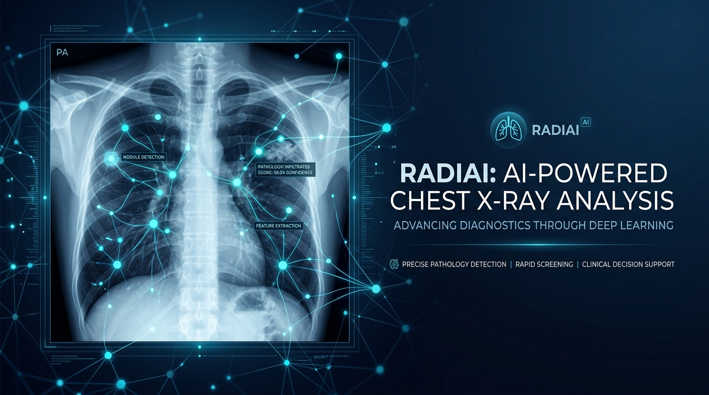
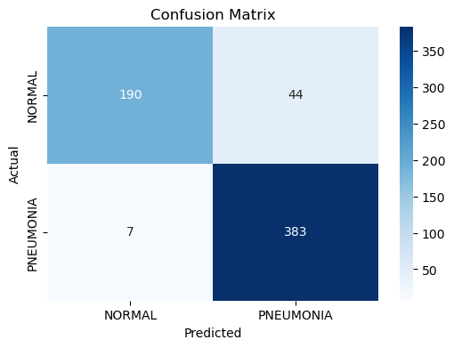
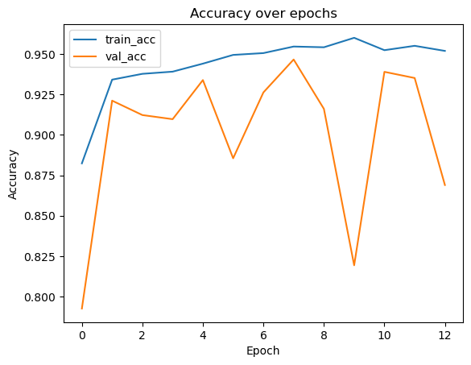
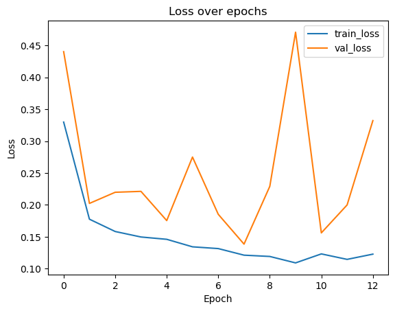
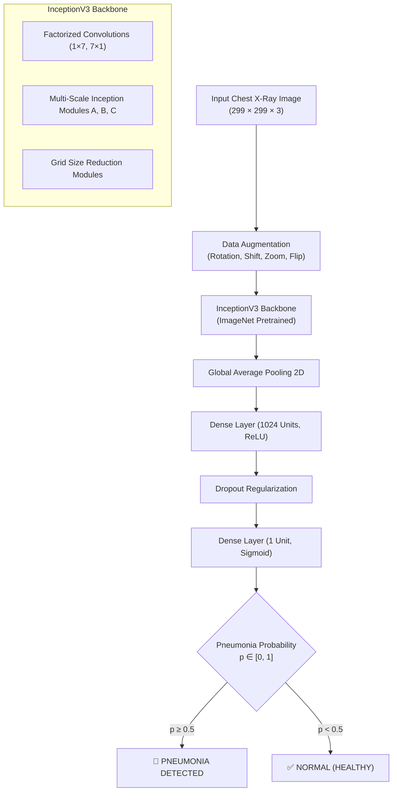

<div align="center">

#  Pneumonia Detection from Chest X-Rays via Transfer Learning (InceptionV3)

[](https://www.python.org/)
[](https://www.tensorflow.org/)
[](https://keras.io/)
[](LICENSE)
[](https://github.com/yassiradila/Pneumonia_Detection_Deep_Learning/actions)
[](https://www.kaggle.com/datasets/paultimothymooney/chest-xray-pneumonia)
[](https://ensa.uae.ac.ma)

<p align="center">
  <b>A production-ready Deep Learning framework for automated pneumonia screening from pediatric chest radiographs.</b>
  <br>
  <i>Achieving <b>91.83% Test Accuracy</b> and an outstanding <b>98.0% Recall (Sensitivity)</b> on unseen clinical test images.</i>
</p>



</div>

---

## 📌 Table of Contents

- [Overview & Clinical Motivation](#-overview--clinical-motivation)
- [Key Performance Metrics](#-key-performance-metrics)
- [Comparative Benchmark Analysis](#-comparative-benchmark-analysis)
- [Model Architecture & Methodology](#-model-architecture--methodology)
- [Dataset & Split Rebalancing](#-dataset--split-rebalancing)
- [Repository Structure](#-repository-structure)
- [Getting Started & Installation](#-getting-started--installation)
- [Usage Guide](#-usage-guide)
  - [1. Interactive Jupyter Notebook](#1-interactive-jupyter-notebook)
  - [2. CLI Training Pipeline](#2-cli-training-pipeline)
  - [3. CLI Model Evaluation](#3-cli-model-evaluation)
  - [4. Single-Image Diagnostic Inference](#4-single-image-diagnostic-inference)
- [Academic Report & Research Documentation](#-academic-report--research-documentation)
- [Authors & Academic Affiliation](#-authors--academic-affiliation)
- [Citation & License](#-citation--license)

---

## 🔬 Overview & Clinical Motivation

Pneumonia is an acute respiratory infection affecting the lungs, accounting for millions of hospital admissions globally each year and remaining one of the leading causes of pediatric mortality. While chest radiography (X-ray) is the standard diagnostic imaging modality, manual radiograph interpretation is time-consuming and prone to inter-observer variability, particularly in resource-constrained clinics.

This project delivers an automated computer vision screening system based on **InceptionV3 Transfer Learning**. The model is designed specifically to prioritize **clinical safety**:

> [!IMPORTANT]
> **Why Recall (Sensitivity) is the Golden Metric in Medical Screening:**  
> In diagnostic AI, a **False Negative** (declaring a sick patient healthy) can lead to delayed treatment and critical prognosis, whereas a **False Positive** merely triggers secondary radiologist review. Our model achieves **98.0% Recall** on pneumonia cases (only **8 false negatives out of 390 cases**), ensuring almost zero missed pathologies.

---

## 📊 Key Performance Metrics

The model was evaluated on an independent, unseen test dataset of **624 chest radiographs** (234 Normal, 390 Pneumonia):

| Metric | Score | Clinical Relevance |
| :--- | :---: | :--- |
| **Test Accuracy** | **91.83%** | Overall correct classification rate on unseen cases |
| **Pneumonia Recall (Sensitivity)** | **98.0%** | **382 of 390** pneumonia cases correctly identified |
| **Pneumonia Precision** | **90.0%** | 382 true positives out of 426 positive calls |
| **Normal Specificity (TNR)** | **81.2%** | Correct rejection rate for healthy patients |
| **Pneumonia F1-Score** | **0.94** | Harmonious balance between precision & recall |
| **Test Loss** | **0.2490** | Low cross-entropy loss on test set |

<div align="center">
  <table>
    <tr>
      <td align="center"><b>Confusion Matrix</b></td>
      <td align="center"><b>Training Accuracy & Loss Curves</b></td>
    </tr>
    <tr>
      <td></td>
      <td>
        <br>
        
      </td>
    </tr>
  </table>
</div>

### Detailed Classification Report

```text
              precision    recall  f1-score   support

      NORMAL       0.96      0.81      0.88       234
   PNEUMONIA       0.90      0.98      0.94       390

    accuracy                           0.92       624
   macro avg       0.93      0.90      0.91       624
weighted avg       0.92      0.92      0.92       624
```

---

## 🏆 Comparative Benchmark Analysis

As documented in our comprehensive academic study at **ENSA Tétouan**, multiple deep learning architectures were trained and rigorously evaluated under identical experimental standards on the Chest X-Ray dataset:

| Model Architecture | Test Accuracy | Pneumonia Recall | False Positives | False Negatives | Key Assessment |
| :--- | :---: | :---: | :---: | :---: | :--- |
| **InceptionV3 (This Work)** | **91.83%** | **98.0%** | 44 | **8** | **Best Clinical Sensitivity:** Minimal missed cases |
| **Custom CNN** | **92.63%** | 95.6% | 29 | 17 | Balanced accuracy, lightweight footprint |
| **VGG16** | **91.00%** | 96.9% | 42 | 12 | Strong discrimination (AUC = 0.97) |
| **DenseNet101** | **86.37%** | 92.1% | 58 | 27 | High train/val accuracy, lower generalization |
| **ResNet50** | **62.50%** | 100.0% | 234 | 0 | Over-predicted positive class |

---

## 🏗️ Model Architecture & Methodology



### Two-Stage Transfer Learning Protocol

1. **Phase 1: Feature Extraction (Frozen Backbone)**
   - All layers of the InceptionV3 backbone are frozen (`trainable = False`).
   - The newly attached classification head is trained with **Adam** ($\text{lr} = 10^{-3}$) for up to 20 epochs.
   - Guarded by `EarlyStopping(patience=5)` and `ModelCheckpoint(save_best_only=True)`.

2. **Phase 2: Fine-Tuning (Unfreezing Top Layers)**
   - The top 100 layers of InceptionV3 are unfrozen to adapt high-level visual representations to radiographic domain features.
   - Retrained with a conservative learning rate ($\text{lr} = 10^{-5}$) for 10 epochs to prevent catastrophic forgetting.

---

## 📁 Dataset & Split Rebalancing

We utilize the benchmark **Chest X-Ray Images (Pneumonia)** dataset by Kermany et al. ([Kaggle Dataset](https://www.kaggle.com/datasets/paultimothymooney/chest-xray-pneumonia)):
- **Total Images:** 5,863 pediatric chest radiographs.
- **Classes:** `NORMAL` vs. `PNEUMONIA` (Bacterial and Viral).

> [!TIP]
> **Dataset Split Rebalancing Note:**  
> The original public dataset suffered from an extreme validation set imbalance (only 16 images in `val`). In accordance with our study methodology, a stratified subset of training radiographs was redirected into the validation set, creating a statistically robust validation benchmark for hyperparameter tuning and early stopping.

---

## 📂 Repository Structure

```text
pneumonia-detection-inceptionv3/
├── .github/
│   └── workflows/
│       └── ci.yml                     # Automated GitHub Actions test pipeline
├── assets/
│   ├── banner.png                     # Project banner graphic
│   ├── confusion_matrix.png           # Test set confusion matrix
│   ├── accuracy_curve.png             # Epoch accuracy visualization
│   └── loss_curve.png                 # Epoch loss visualization
├── docs/
│   └── Rapport_Projet_Machine_Learning.pdf  # 71-page comprehensive academic thesis report
├── notebooks/
│   └── Pneumonia_Detection_Inception_V3.ipynb # Documented Jupyter training notebook
├── src/
│   ├── __init__.py                    # Package initialization and exports
│   ├── config.py                      # Hyperparameters, dimensions, and paths
│   ├── dataset.py                     # Data augmentation generators & preprocessing
│   ├── model.py                       # InceptionV3 architecture & fine-tuning utilities
│   ├── train.py                       # Full CLI training script
│   ├── evaluate.py                    # Test set evaluation and metric generation
│   └── predict.py                     # Single-image diagnostic inference CLI
├── tests/
│   ├── __init__.py
│   └── test_pipeline.py               # Unit tests (Config, Preprocessing, Architecture)
├── .gitattributes                     # Git line endings and binary configuration
├── .gitignore                         # Comprehensive ML gitignore (.h5, .keras, data/)
├── CITATION.cff                       # Academic citation metadata
├── CONTRIBUTING.md                    # Guidelines for contributors
├── environment.yml                    # Conda environment file
├── LICENSE                            # MIT License
├── Makefile                           # Automation commands (test, clean, install)
├── pyproject.toml                     # Modern Python packaging configuration
├── requirements.txt                   # Production dependencies
└── README.md                          # Project documentation (this file)
```

---

## 🚀 Getting Started & Installation

### Prerequisites
- Python 3.9, 3.10, or 3.11
- Git
- Recommended: NVIDIA GPU with CUDA for training acceleration (CPU supported for inference)

### 1. Clone the Repository
```bash
git clone https://github.com/yassiradila/Pneumonia_Detection_Deep_Learning.git
cd Pneumonia_Detection_Deep_Learning
```

### 2. Create and Activate Virtual Environment
```bash
# On Linux / macOS
python3 -m venv .venv
source .venv/bin/activate

# On Windows (PowerShell)
python -m venv .venv
.venv\Scripts\Activate.ps1
```

### 3. Install Dependencies
```bash
pip install --upgrade pip
pip install -r requirements.txt
```

*(Alternatively, if using Conda:)*
```bash
conda env create -f environment.yml
conda activate pneumonia-detection
```

### 4. Run the Unit Test Suite
Verify that all core components and architectures build correctly:
```bash
python -m unittest discover tests
```

---

## 💻 Usage Guide

### 1. Interactive Jupyter Notebook
To step through the interactive pipeline, data exploration, training logs, and visualizations:
```bash
jupyter notebook notebooks/Pneumonia_Detection_Inception_V3.ipynb
```

### 2. CLI Training Pipeline
Train the two-phase InceptionV3 model from the command line:
```bash
python -m src.train \
    --data-dir data/chest_xray \
    --batch-size 32 \
    --epochs-phase1 20 \
    --epochs-phase2 10 \
    --save-model pneumonia_inceptionv3.keras
```

### 3. CLI Model Evaluation
Evaluate any saved model on the test set and output metrics with an updated confusion matrix:
```bash
python -m src.evaluate \
    --model-path pneumonia_inceptionv3.keras \
    --data-dir data/chest_xray \
    --output-dir assets
```

### 4. Single-Image Diagnostic Inference
Run screening on an individual patient radiograph:
```bash
python -m src.predict \
    --image path/to/patient_xray.jpeg \
    --model pneumonia_inceptionv3.keras
```

**Example Console Output:**
```text
=======================================================
        CHEST X-RAY DIAGNOSTIC INFERENCE
=======================================================
 Image:          patient_xray.jpeg
 Diagnosis:      PNEUMONIA
 Confidence:     97.84%
 Pneumonia Prob: 97.84%
 Assessment:     High Suspicion (Severe Indicators Detected)
=======================================================
 Note: For clinical decision support only. Not a standalone diagnosis.
```

Or output raw JSON for integration into PACS or web APIs:
```bash
python -m src.predict --image path/to/patient_xray.jpeg --model pneumonia_inceptionv3.keras --json
```

---

## 📑 Academic Report & Research Documentation

For an in-depth theoretical analysis, including:
- Mathematical derivations of factorized convolutions ($1 \times 7$ and $7 \times 1$)
- Gradient propagation analysis and auxiliary classifiers
- In-depth ablation studies comparing **InceptionV3**, **VGG16**, **ResNet50**, **DenseNet101**, and **Custom CNN**

Consult the full **71-page academic thesis report**:
📄 [**`docs/Rapport_Projet_Machine_Learning.pdf`**](docs/Rapport_Projet_Machine_Learning.pdf)

---

## 👥 Authors & Academic Affiliation

This project was conducted at the **National School of Applied Sciences of Tetouan** (*École Nationale des Sciences Appliquées de Tétouan - ENSA Tétouan*), **Abdelmalek Essaâdi University**, Morocco.

- **Filière:** Master / Cycle d'Ingénieur en Science des Données, Big Data et Intelligence Artificielle
- **Département:** Intelligence Artificielle et Digitalisation (IAD)
- **Supervising Professor:** **Prof. Imane HACHCHANE** (*Professeure d’apprentissage automatique*)

### Research Team:
- **Yassir Adila** — *InceptionV3 Architecture, Transfer Learning & Evaluation Pipeline* (Apogée: 22048197)
- **Mohamed Channa** — *Custom CNN Architecture* (Apogée: 22053046)
- **Aymane Azaagag** — *VGG16 & VGG19 Architectures* (Apogée: 22049082)
- **Mohamed Abrini** — *DenseNet Architecture* (Apogée: 22043791)
- **Aymane Hayoun** — *ResNet Architecture* (Apogée: 22049899)

---

## 📜 Citation & License

If you use this repository or its findings in your research or academic work, please cite it:

```bibtex
@misc{adila2024pneumoniadetection,
  author       = {Yassir Adila and Mohamed Channa and Aymane Azaagag and Mohamed Abrini and Aymane Hayoun},
  title        = {Pneumonia Detection from Chest X-Ray Images using Transfer Learning (InceptionV3)},
  year         = {2024},
  publisher    = {GitHub},
  howpublished = {\url{https://github.com/yassiradila/Pneumonia_Detection_Deep_Learning}},
  institution  = {Ecole Nationale des Sciences Appliquees de Tetouan (ENSA Tetouan)}
}
```

This project is licensed under the **[MIT License](LICENSE)**.
